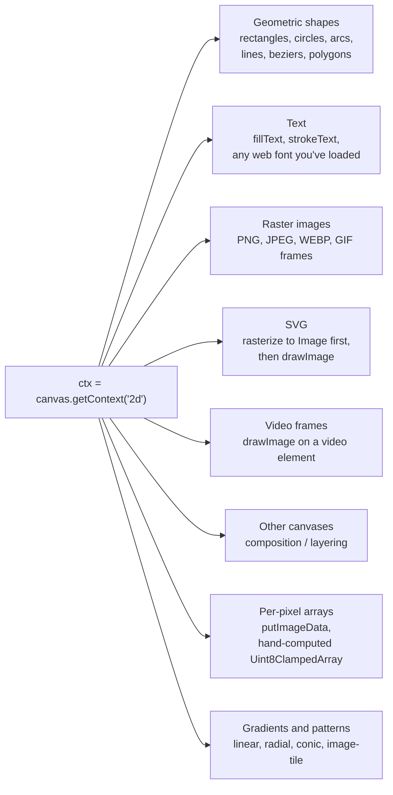

**A `<canvas>` is a programmable sheet of paper.** Everything that ends up on it gets there because some JavaScript told it to. There's no markup, no CSS layout, no DOM children — just a 2D grid of pixels and a set of drawing commands that change them.

So "what can you put in a canvas?" really means: "what can you call from JavaScript to leave a mark?" The answer turns out to be surprisingly broad.

## The big categories



Each of these is just a method on the 2D context object. You compose a frame by calling them in sequence; whatever you call last wins (well, modulo blend modes — see below).

## What each one actually looks like

### Shapes

The classic primitives. Rectangles are the most direct; everything else is paths.

```js
ctx.fillStyle = '#FF6CB4';
ctx.fillRect(10, 10, 100, 50);    // filled rectangle

ctx.beginPath();
ctx.arc(200, 100, 40, 0, Math.PI * 2);  // circle
ctx.fill();

ctx.beginPath();
ctx.moveTo(50, 200);
ctx.bezierCurveTo(80, 150, 200, 250, 250, 200);  // smooth curve
ctx.stroke();
```

### Text

`fillText` uses **whatever font the browser has currently loaded** — it routes through the OS font renderer, the same one a `<p>` tag would use. This is why VT323 from Google Fonts works in `trinitron.js`'s signal callback: the page has already loaded VT323 for the rest of the design, and the canvas inherits it through `ctx.font`.

```js
ctx.font = '18px "VT323", monospace';
ctx.fillStyle = '#44FF8A';
ctx.fillText('mirepoix@is-2200:~$ mesh status', 10, 30);
```

You can measure text width with `ctx.measureText('whatever').width` — useful when you need to position adjacent runs without hardcoding character widths.

### Raster images

Any image the browser can load (PNG, JPEG, WEBP, AVIF, animated GIF current frame, etc.) can be drawn onto a canvas via `drawImage`:

```js
const img = new Image();
img.onload = () => ctx.drawImage(img, 0, 0);
img.src = '/sneak-screenshot.png';
```

`drawImage` is overloaded: you can draw at native size, scale, or even crop a rectangle out of the source.

### SVG

SVG is a special case because the canvas API doesn't directly accept it — but it accepts `Image` objects, and `Image` can load SVG. So the trick is:

1. Build the SVG markup in JS (or fetch it).
2. Wrap it in a Blob with type `image/svg+xml`.
3. `URL.createObjectURL` gives you a URL the `Image` can load.
4. Once it loads, you `drawImage` it like any other raster.

That's exactly what `trinitron.js` does for the Interslice logo: it inlines SVG markup, rasterizes it through a blob URL, and feeds the resulting `Image` to the signal callback.

### Video frames

A `<video>` element can be passed straight to `drawImage`. The canvas grabs *the current frame*, whatever the video is showing at that instant. If you call it every animation frame, you're effectively turning a video into a live texture.

```js
ctx.drawImage(videoElement, 0, 0);
```

This is how WebRTC apps composite live camera feeds, and how some video effects work — the video plays in a hidden element while a canvas snapshots its frames and processes them.

### Other canvases

`drawImage` accepts a `<canvas>` element too. This is how you compose layers: paint into an offscreen canvas, then draw that canvas into another. `trinitron.js` does this heavily — the signal canvas, three convergence canvases, the stripe canvas, the bleed canvas, and the gap-mask canvas are all separate `<canvas>` elements that get composed onto the final visible one.

### Per-pixel manipulation

The escape hatch. `getImageData` reads pixels into a `Uint8ClampedArray` (RGBA, 4 bytes per pixel). You can manipulate that array directly, then `putImageData` writes it back.

```js
const data = ctx.getImageData(0, 0, 100, 100);
for (let i = 0; i < data.data.length; i += 4) {
  data.data[i] = 255 - data.data[i];     // invert R
  data.data[i + 1] = 255 - data.data[i + 1]; // invert G
  data.data[i + 2] = 255 - data.data[i + 2]; // invert B
  // i + 3 is alpha
}
ctx.putImageData(data, 0, 0);
```

This is what `trinitron.js` does in its hot loop — it reads pixel data from three convergence canvases, computes the phosphor cell value per pixel, and writes the result back via `putImageData`. Slower than high-level drawing calls, but it's the only way to do per-pixel math.

### Gradients and patterns

Gradients are objects you assign to `fillStyle` or `strokeStyle`:

```js
const grad = ctx.createLinearGradient(0, 0, 200, 0);
grad.addColorStop(0, '#FF6CB4');
grad.addColorStop(1, '#5EE2FF');
ctx.fillStyle = grad;
ctx.fillRect(0, 0, 200, 50);
```

Patterns let you tile an image:

```js
const pattern = ctx.createPattern(img, 'repeat');
ctx.fillStyle = pattern;
ctx.fillRect(0, 0, 500, 500);
```

## And the controls layered on top

These don't put new content on the canvas; they change how the next drawing operation behaves:

- **Transforms** — `translate`, `rotate`, `scale`, `transform` (full matrix). Affect everything drawn after them. Save/restore with `ctx.save()` / `ctx.restore()`.
- **Blend modes** — `globalCompositeOperation = 'multiply'` (or `'screen'`, `'overlay'`, `'source-atop'`, etc.). Same family as Photoshop layer blend modes.
- **Alpha** — `globalAlpha = 0.5` makes everything drawn next 50% transparent.
- **Clipping** — set a path, then `ctx.clip()` confines all subsequent drawing to inside that path.
- **Filters** — `ctx.filter = 'blur(5px) brightness(1.2)'` applies a CSS-style filter to the next drawing operation. `trinitron.js` uses this for its halo (blur + brightness on the bleed canvas).

## What you specifically can't do

- **No live DOM inside a canvas.** No `<div>`, no `<a href>`, no buttons. Once you draw text, it's just pixels — you can't click on it, you can't select it, screen readers can't see it.
- **No CSS layout.** Flexbox, grid, line-wrapping — you compute all of that yourself. Want word-wrapped text? Measure each word with `measureText`, decide line breaks, render each line separately.
- **No 3D directly in 2D context.** For 3D you'd switch to `getContext('webgl')` or `getContext('webgpu')` and write shaders.
- **No HTML rasterization without a workaround.** You can't pass a `<div>` to `drawImage`. The workaround is to embed your HTML inside an `<svg>` element using `<foreignObject>`, then rasterize that SVG. It's cursed but it works.

## So what?

This is why `trinitron.js` is **content-agnostic**. Its signal callback receives a 2D context and says "paint whatever you want." For the Interslice logo, "whatever you want" was rasterized SVG. For the IS-2200 screen, it's text via `fillText`. Tomorrow it could be:

- A live xterm.js-style terminal buffer, with real keystroke input.
- A video feed (drawImage a video element 60 times per second).
- A scrolling marquee, a status panel, a meter, a sparkline.
- A composition of all of the above.

The Trinitron renderer doesn't know or care. Each frame it just reads whatever pixels are there and applies the phosphor pass. The expressive ceiling of the IS-2200's "screen" is the expressive ceiling of `<canvas>` itself — which, as you can see, is most of computer graphics.
