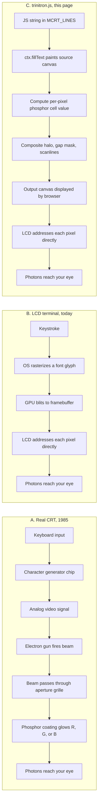

**`trinitron.js` is a software simulation of what a Sony Trinitron CRT would look like with text on it.** Not an emulator of an old computer, and not CSS filters either. Closer to *a photograph of a CRT, computed in real time*.

## The three answers you're considering

You're asking which of these we're doing:

1. **Emulating a 1980s computer's display hardware** — like, are we secretly an Apple ][ with a real character ROM and a real video signal?
2. **Stacking CSS filters** — `filter: blur(2px) hue-rotate(...)` and calling it CRT?
3. **Something else**

The answer is **3**. The "something else" is interesting enough that the other two miss it from opposite sides.

## The studio analogy

Imagine a photo studio. There's a real Sony Trinitron monitor on a desk, powered on, displaying some text. A photographer takes a high-resolution photo. The photo isn't a CRT — it's a record of *the light a CRT throws*, frozen.

Now imagine the studio is empty. No monitor, no photographer. Just a computer drawing a picture that would look exactly like that photograph, working from a description of what CRTs *do* to an input image. That's `trinitron.js`.

It doesn't know what voltage was on the deflection yoke. It doesn't know how many scan lines NTSC has. It doesn't replay any historical hardware. It computes, every frame, what the *optical output* of a CRT-style display would look like for the input it's given.

## Three pipelines, side by side

In pipeline **A**, the optical effects — colored stripes, beam bleed, persistence glow — come from **physics**. Electrons hit phosphor through a metal grille, and that's what physics does.

In pipeline **B**, there are no optical effects at all. Pixels are crisp. The LCD is told "pixel at (x, y) is RGB (200, 150, 50)" and it does exactly that.

In pipeline **C**, the optical effects are **calculated**. We compute, per output pixel, what a phosphor at that location *would have* emitted *if* an electron beam *had* struck it through *a hypothetical* aperture grille. The math is heuristic — tuned by eye, not derived from Sony service manuals — but it's real per-pixel computation, not a filter applied to the whole image.

## What's actually in the pipeline

The hot loop in `trinitron.js`, simplified:

1. Take the **input signal** — whatever the page painted into the source canvas. For the IS-2200 screen, that's text from `ctx.fillText` calls reading from a JS data model.

2. Make **three offset copies** of the signal: one shifted slightly left for the R channel, one centered for G, one shifted right for B. This simulates **convergence error** — real CRTs can't perfectly align their three electron guns, so colored fringes appear at edges.

3. For each output pixel, do this fused calculation:
   - Figure out which phosphor stripe you're inside (R, G, or B column).
   - Sample only that channel's pre-shifted copy of the signal.
   - Multiply by the stripe pattern (how brightly does this column emit?).
   - Multiply by a hotspot brightness profile (the center of each cell is brighter, like a real phosphor dot).
   - Add tiny per-cell and per-row shimmer (stable noise, like real phosphor variation).

4. **Mix with the previous frame's value** at the same pixel — this simulates **phosphor persistence**, the way old CRTs kept glowing for a moment after the beam moved on.

5. Take the original signal, **blur it**, and composite it underneath as a soft halo. This simulates **beam bleed** through the glass face of the tube — a real CRT's light doesn't stop where the beam stopped; it spreads.

6. Lay a **dark vertical-line mask** on top of everything. This simulates the **aperture grille** — the metal slits inside a Trinitron that keep the beam pointed at the right phosphor color, and which you can faintly see as vertical dark lines on a real Trinitron screen.

That's roughly 600 lines of JavaScript running at ~2ms per frame. It's not CSS in a trenchcoat. It's a real 2D rendering pipeline.

## So what level of "computing" is this, really?

The closest match in modern terms: a **post-process shader**. Specifically, the kind that lives in retro game emulators like RetroArch — those have whole libraries of CRT shaders that simulate aperture grilles, shadow masks, persistence, NTSC color artifacts, etc.

| Real CRT (Trinitron) | RetroArch CRT shader | `trinitron.js` |
|---|---|---|
| Hardware. Electrons and phosphors. | GPU code, computes per-pixel. | CPU code, computes per-pixel. |
| Takes a video signal as input. | Takes a rendered framebuffer as input. | Takes a `<canvas>` painted by JS as input. |
| Authentic by definition. | Tuned by eye to look authentic. | Tuned by eye to look authentic. |
| Outputs photons via phosphor + glass. | Outputs a transformed framebuffer to the LCD. | Outputs a `<canvas>` displayed by the browser to the LCD. |

The interesting thing about pipeline C versus pipeline A: in the real CRT, the optical effects are *unavoidable* — the hardware can't display without them. In `trinitron.js`, they're *optional and parameterized*. You can dial down the bleed, narrow the stripes, kill the halo — pieces of a real Trinitron's "look" that you'd have needed a different physical monitor to change.

## What it specifically is NOT

- **Not an emulator of an 80s/90s computer.** There's no Z80 or 6502, no display controller chip simulation, no character ROM. The text font (VT323) is just a Google Font.
- **Not a hardware-accurate physics simulation.** No electron trajectories, no phosphor chemistry, no temperature model. Just an empirical model of what CRTs *appear to do*.
- **Not running on a GPU.** It uses the 2D `<canvas>` API on the CPU. Slower than a shader, but works without WebGL and stays under the 16ms-per-frame budget for this size of widget.
- **Not coupled to the content.** The same renderer drives the Interslice logo and the IS-2200 terminal screen — it doesn't know or care which is which. It just sees pixels in, pushes pixels out.

## So what?

When you look at the IS-2200 screen on the page, here's what's happening 60 times per second:

1. A JavaScript function paints text strings into an offscreen `<canvas>`.
2. A second function reads those pixels and computes, for each output pixel, what a phosphor at that location would have looked like if a CRT beam had drawn this image.
3. The result lands in a visible `<canvas>` element, which the browser shows on your LCD.

The text content is a JS array of strings today. Tomorrow it could be a full xterm.js-style character-grid terminal with keystroke handling — the renderer wouldn't need to change at all, because it doesn't know it's rendering text. It just renders pixels through a simulated picture tube.

That's the most honest answer: it's not retro, it's not fake, it's a working approximation of optical physics, computed live.
