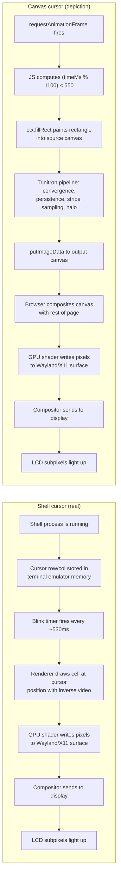

**Both cursors are little rectangles that turn on and off on your LCD. The difference is everything that happens before "rectangle turns on."**

Your shell's cursor is **the cursor**. It represents an actual input position — type a letter and that letter appears where the cursor is. Move the cursor with arrow keys, the input position moves with it. It's a control surface tied to a running process.

The cursor on the IS-2200 screen is **a picture of a cursor**. There's no input position. Nothing happens if you "click" where it's blinking. It's a depiction of what a cursor would look like on a CRT, drawn by a chain of code that knows nothing about you typing.

Same pixels, very different stories about why those pixels are on.

## The "from" / "of" distinction

The shell cursor is *from* hardware. It originates as input/output state in a running program — a row and column coordinate held in the terminal emulator's memory, kept in sync with the shell process.

The canvas cursor is *of* hardware. It's a graphical idea about what hardware looks like — specifically, what a Trinitron CRT's cursor would look like, drawn frame-by-frame by JavaScript that has never met an actual CRT.

Both end up as identical pixels. But one is *plumbed into a real system*; the other is *a self-contained painting that happens to depict a system*.

## Side-by-side: from "cursor exists" to "pixel lights up"

Three things jump out from this comparison.

**1. The shell cursor exists as a piece of state.** Somewhere in your terminal emulator's process memory there is a struct that says "cursor is at row 12, column 0, visible this tick, not visible next tick." That struct is the cursor. The pixels are a render of it.

**The canvas cursor does not exist as state.** Nowhere is there a variable that says "cursor visible" or "cursor at line 6, column 30." Every frame, the rendering function looks at the wall clock, does `(timeMs % 1100) < 550`, and if the answer is true, it paints a rectangle. Next frame it does the math again. The cursor is **continuously re-derived** from arithmetic; it has no persistent existence.

**2. The shell cursor is plumbed.** Pressing a key sends bytes to the shell, which echoes them, which advances the cursor's row/col, which the renderer picks up on the next tick. The whole chain is *bi-directional* — input flows up, output flows down.

**The canvas cursor is decorative.** No input is wired to it. If you click on it, nothing happens. The signal callback wouldn't even know.

**3. The chain is longer.** Shell cursor: ~6 hops from "cursor exists" to "pixel lights up." Canvas cursor: ~9 hops, because we inserted an entire fake CRT in the middle (convergence, persistence, stripe sampling, halo compositing) and we did it in JavaScript instead of native code.

## Why this confuses you (and why it shouldn't anymore)

Here's the thing — the abstraction levels are *legitimately stacked weirdly*. The IS-2200 screen is:

- A simulation of a 1990s phosphor CRT
- Running on an LCD made in the 2020s
- Driven by JavaScript (a 1995 interpreted language)
- Painted into HTML5 canvas (a 2010 API)
- Composited by a browser (~30M lines of C++)
- Onto a Wayland display server (a 2008 protocol)
- Talking to a GPU driver
- Talking to an actual GPU
- Producing photons via subpixel transistors on a glass panel

The cursor blinking inside that screen is **inside the simulation, not on top of the LCD**. The LCD doesn't know it's showing a cursor — it's showing a piece of an image that *depicts* a cursor inside a *depiction* of a CRT. The actual LCD subpixel pattern doesn't change in the cursor area between blink-on and blink-off in any "cursor-flavored" way; it just changes pixel values that happen to make a rectangle visible at one moment and not the next.

Meanwhile, your **shell's cursor** is right there in your terminal, and *its* pixels are also subpixels on the same LCD. But it has only **one layer of "this depicts something."** The terminal emulator draws a cursor because there *is* a cursor — a real position in a real text buffer, in a real shell, on a real machine.

## A useful test

Want to feel where the abstraction layers are? Try these:

- **Press an arrow key** while your shell is focused. The shell cursor moves. The pixels change because the *cursor state* changed.
- **Press an arrow key** while looking at the IS-2200 screen. Nothing. The cursor keeps blinking in the same spot. The pixels are not connected to any state that arrow keys can move.
- **Open a system process viewer.** You can find the shell process. You can find the terminal emulator process. You cannot find the IS-2200 cursor; it has no process, no memory, no name in any list. It is a transient pattern of computed pixels.

## So what?

The shell cursor and the canvas cursor look interchangeable but answer to different masters. One is plumbing; the other is stagecraft.

When you look at the IS-2200 page and feel like you can't tell what layer you're at — that's actually correct. The page is *deliberately ambiguous* between "this is a real terminal" and "this is a picture of a terminal." Right now it's firmly the latter. The fact that you can't tell at a glance is a compliment to the rendering. The fact that the arrow keys don't do anything is the giveaway.

If you ever wanted to *make* it real — wire up keystroke handling, give the cursor a real row/col it tracks, let the user type — the canvas pipeline wouldn't need to change at all. You'd just be adding the *plumbing* that turns the painting into a thing. That's the path from depiction to system, and it's a known route. We just haven't taken it yet.
