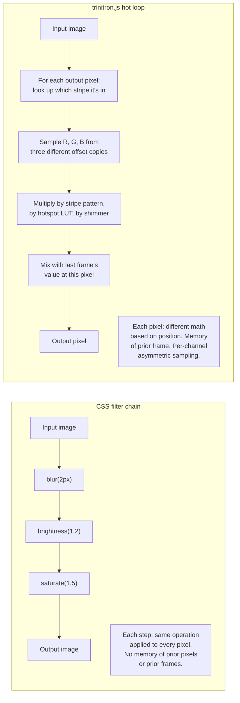

**CSS filters are a fixed menu of about ten ready-made effects. `trinitron.js` is hand-written math that runs against every pixel.**

The difference isn't *what they look like* — you can make CSS filters look superficially CRT-ish. The difference is *what they're allowed to do*. CSS filters are constrained in ways that matter for this kind of effect, and the constraints are the whole story.

## What CSS filters actually are

CSS gives you a chain of pre-built image operations:

```css
.thing {
  filter: blur(2px) brightness(1.2) saturate(1.5) hue-rotate(15deg);
}
```

Each function name is a built-in. The browser knows what `blur` means, what `saturate` means, etc. You pick from this menu:

| Function | What it does |
|---|---|
| `blur(Npx)` | Gaussian blur, same amount everywhere |
| `brightness(N)` | Multiply all RGB values by N |
| `contrast(N)` | Stretch the brightness range around 50% |
| `saturate(N)` | Push colors toward / away from gray |
| `hue-rotate(Ndeg)` | Spin the color wheel uniformly |
| `invert(N)` | Flip values toward their opposite |
| `grayscale(N)` | Desaturate uniformly |
| `sepia(N)` | Old-photo tint |
| `drop-shadow(...)` | Outline glow / shadow |
| `opacity(N)` | Same as `opacity: N` |
| `url(#svg)` | Apply an SVG filter (slightly more power, see below) |

That's basically the whole vocabulary. You can chain them, but each link in the chain still picks from the same menu.

## What's missing from the menu



Concretely, here are the things CSS filters **can't** do that `trinitron.js` does on every frame:

**1. Different math per pixel.** `blur(2px)` blurs every pixel the same way. There's no way to say "the pixels at column 0 mod 6 should be the R sample, the pixels at column 2 mod 6 should be the G sample, the pixels at column 4 mod 6 should be the B sample." Every pixel gets the same treatment.

`trinitron.js`'s hot loop computes which **phosphor stripe** a pixel belongs to based on its (x, y) and applies different math depending on the answer. That's per-pixel branching, which CSS filters fundamentally don't have.

**2. Per-channel asymmetric sampling.** `hue-rotate` spins all three channels together. There's no `shift_red(-0.5px) shift_blue(+0.5px)` filter. But that's exactly what **convergence error** on a real CRT looks like — the three electron guns can't perfectly converge, so red and blue fringes appear at edges.

`trinitron.js` makes three pre-shifted copies of the input — R shifted left, B shifted right, G unchanged — and samples each channel from its own copy. No combination of CSS filters reproduces this.

**3. Memory of the previous frame.** CSS filters are *stateless*. The output of frame N is computed from the input of frame N. There is no `mix_with_previous(0.85)` filter.

`trinitron.js` keeps the prior frame's output in a typed array and *blends* it with the new frame's input. That's **phosphor persistence** — the soft afterglow real CRTs have because the chemical coating keeps emitting light for a moment after the beam moved on. Without state, you can't have decay.

**4. Procedural pattern generation.** CSS filters consume an input image; they can't *generate* one. There's no `add_noise(0.04)` filter, no `add_stripe_pattern(period: 3)` filter, no `add_hotspot_grid(cellSize: 3)` filter.

`trinitron.js` builds lookup tables at init time (stripe weights per column, hotspot brightness per sub-cell, shimmer noise per row), then multiplies them into the per-pixel math. Those tables don't exist as "an image"; they're functions baked into arrays.

**5. Conditional logic.** No CSS filter is conditional. There is no `if pixel.alpha > 0.5 then ... else ...`.

`trinitron.js` decides per pixel whether to apply the gap mask, whether the pixel is inside the silhouette (alpha-aware), and whether shimmer should bias it brighter or darker.

## "But what about SVG filters?"

You can do **more** with SVG filters than with plain CSS filters — `feColorMatrix`, `feOffset`, `feComposite`, `feTurbulence` for noise, etc. You could conceivably build a *static* CRT-look filter by chaining these.

What you still can't get from SVG filters:

- **Per-frame state.** SVG filters re-evaluate from scratch each frame. No persistence.
- **Per-pixel JavaScript.** SVG filters are a declarative graph of pre-built nodes. You can't drop into a loop and decide pixel-by-pixel what to do.
- **Hot-path performance for complex effects.** SVG filters are interpreted by the browser, not your code. For a real CRT pass with convergence + persistence + striping + halo + gap-mask, you'd be building a tower of `<feMerge>` and `<feComposite>` nodes that's slower and less precise than a direct canvas loop.

SVG filters sit between CSS filters and a custom canvas pipeline in capability. They're more powerful than `filter: blur(5px)`, but they're still declarative and stateless. They can fake a CRT *look* in a still image; they can't simulate a CRT *behavior* over time.

## What this means for the IS-2200

If you had built the IS-2200 screen with CSS filters, you'd have:

```css
.mcrt {
  filter: blur(0.5px) saturate(1.4) brightness(1.1);
  background:
    repeating-linear-gradient(0deg, rgba(255,255,255,0.04) 0 1px, transparent 1px 3px),
    radial-gradient(ellipse at center, transparent 50%, rgba(0,0,0,0.4) 100%);
}
```

(That's *almost exactly what the page had before this work* — and you can see the result: scanlines via repeating-linear-gradient, vignette via radial-gradient, glow via text-shadow. It looked like a CRT in the same way a `sepia(0.8)` photo looks like a daguerreotype: clearly *trying*, clearly not.)

With `trinitron.js` you get:

- The R stripe is *visibly red*, the B stripe is *visibly blue*, because those columns are emitting only those channels.
- Text edges have **chromatic fringes** because the three convergence canvases are sampled at different sub-pixel offsets.
- The cursor doesn't just blink — it **fades in and out** because of persistence carrying state across frames.
- The phosphor pattern has a **hotspot grid** — each cell brighter in the middle, the way real phosphors look under magnification.
- The halo bleeds *outside the source silhouette* because it's computed from the signal's alpha, not from a CSS shadow.

You can squint at a CSS-filter CRT and convince yourself. You can't squint at a real Trinitron and confuse it for a CSS-filter CRT.

## So what?

The fixed-menu nature of CSS filters is the wall you hit. Every visual effect on the web that goes beyond "tint and blur" is, somewhere underneath, hitting that wall and reaching for something more programmable — canvas, WebGL, SVG, or eventually WebGPU. `trinitron.js` is what reaching for canvas looks like when you want to simulate physical optics.

The honest description of the work: **CSS filters are decorations applied to a picture; `trinitron.js` is a simulation that produces a picture.** That difference compounds — each one of those five "missing" features above is a category of effect that's possible in the second world and structurally impossible in the first.

Whenever you see a web effect that feels *uncanny* — like it's pretending to be a physical thing rather than a screenshot of one — odds are someone exited the CSS filter menu and started writing code in the next layer down. That's the layer `trinitron.js` lives in.
